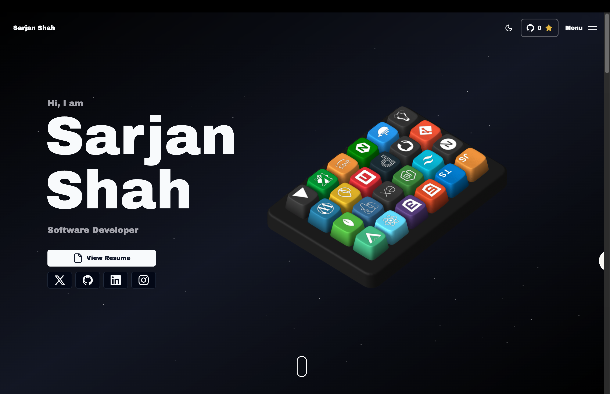

# Sarjan Shah — Portfolio

Source for my personal site, **https://sarjanshah.in**: about, experience, projects, hackathon achievements, blog and resume.



## Credit

This site is built on Naresh Khatri's open-source [3D portfolio template](https://github.com/naresh-khatri/3d-portfolio) (Next.js, Spline 3D keyboard, GSAP animations). My changes are the content and the sections around it: bio, experience, skills, projects, an achievements section for my hackathon results, photos and SEO settings, plus layout fixes for mobile. The template is MIT-licensed, © Naresh Khatri.

## Tech

Next.js 14, React, TypeScript, Tailwind CSS, shadcn/ui, GSAP, Framer Motion, Spline, MDX for blog posts. Deployed on Vercel.

## Where the content lives

```
src/data/config.ts       name, title, social links, SEO
src/data/constants.ts    skills and experience
src/data/projects.tsx    project cards
src/content/blogs/       blog posts (MDX)
src/app/                 pages: home, about, projects, blogs, contact, resume
public/assets/           images
```

## Run it locally

Node 18+:

```bash
npm install
npm run dev        # http://localhost:3000
```
